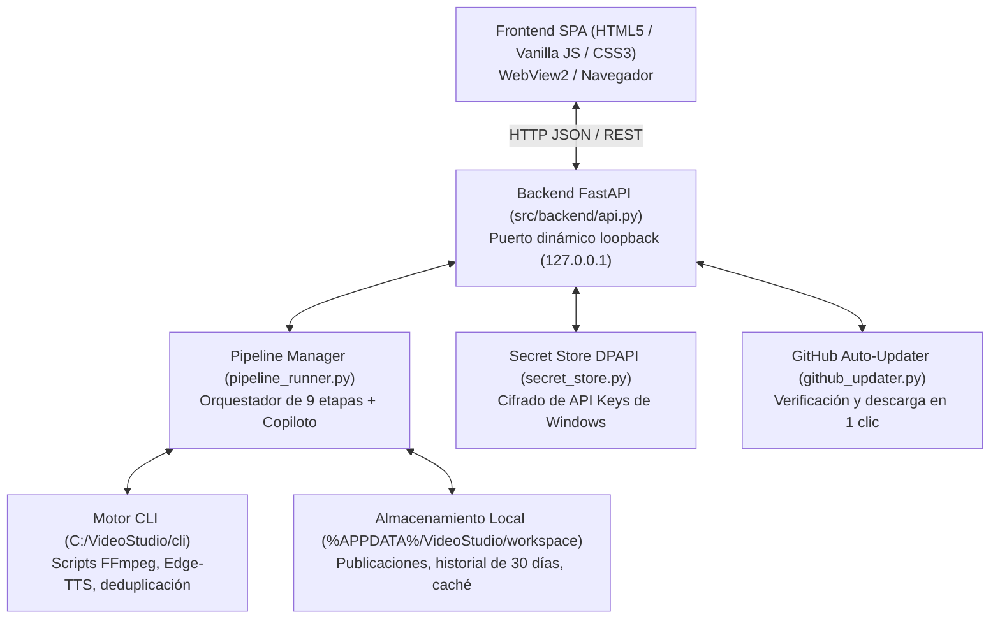

# 🧠 Knowledge Graph — VideoStudio Windows Desktop & Installer

Mapa de arquitectura, ontología de entidades, endpoints de la API, componentes de interfaz y flujos críticos de la aplicación de escritorio Windows.

---

## 1. Arquitectura del Sistema

---

## 2. Mapa de Endpoints de la API (`src/backend/api.py`)

| Método | Endpoint | Responsabilidad |
|---|---|---|
| `GET` | `/api/bootstrap` | Configuración inicial: versión, canales, voces, estado de IA y rutas de trabajo. |
| `GET` | `/api/channels` | Lista de canales y canal activo por defecto. |
| `POST` | `/api/channels` | Crear o registrar nuevo canal con su grupo anti-repetición y voz. |
| `POST` | `/api/channels/active/{id}` | Establecer el canal activo por defecto o `_clear_` para modo libre. |
| `DELETE` | `/api/channels/{id}` | Eliminar canal configurado. |
| `POST` | `/api/pipeline/start` | Iniciar producción de video en modo `copilot` o `autopilot`. |
| `GET` | `/api/pipeline/state` | Estado en tiempo real del pipeline, cronómetros y los 5 visores de entregables. |
| `POST` | `/api/pipeline/copilot` | Enviar visto bueno o selección interactiva del usuario (guión o foto real). |
| `GET` | `/api/gallery` | Biblioteca: lista de videos completados, estado de caché y lista de 30 días con auto-reconciliación de huérfanos. |
| `DELETE` | `/api/gallery` | Eliminar video terminado en disco y liberar su tema de la lista de 30 días. |
| `DELETE` | `/api/gallery/cooldown` | Desbloquear un tema individual (`?topic=...`) o purgar todos los huérfanos (`?all_orphans=true`). |
| `GET` | `/api/media` | Servidor seguro de streaming de video e imágenes locales verificadas. |
| `GET` | `/api/voices/sample/{voice}` | Síntesis en vivo de muestra de voz Edge-TTS. |
| `GET` | `/api/updater/status` | Comprobar si existe una versión más nueva en GitHub Releases. |
| `POST` | `/api/updater/trigger-now` | Descargar instalador y ejecutar actualización en 1 clic. |

---

## 3. Componentes del Frontend (`src/ui/`)

### A. Elementos Clave del DOM (`index.html`):
- `#tab-studio` / `#tab-models` / `#tab-channels` / `#tab-gallery` / `#tab-settings`: Navegación principal por pestañas.
- `#stagesGrid`: Cuadrícula visual de las 6 etapas del pipeline con cronómetros individuales.
- `#copilotCard`: Panel interactivo de aprobación cuando el modo Copiloto entra en pausa (guión o foto).
- **Los 5 Visores de Entregables:**
  - `#prevTrendWrap`: 1. Tendencia seleccionada (brief, ángulo, entidad).
  - `#prevScriptWrap`: 2. Guión Viral (texto completo con botón copiar).
  - `#prevSeoWrap`: 3. Título, Descripción y Tags (pack SEO copiable).
  - `#prevThumbWrap`: 4. Portada viral (miniatura ampliable con Lightbox).
  - `#prevFinalWrap`: 5. Video terminado (reproductor con enlace a carpeta).
- `#imageLightboxBackdrop`: Modal Lightbox de alta resolución para ver miniaturas a pantalla completa.
- `#galleryChannelFilter`: Selector para filtrar la biblioteca y la tabla de 30 días por canal.
- `#cooldownTableBody`: Tabla de temas protegidos con botón `✕ Liberar` y `🧹 Purgar temas de videos borrados`.

### B. Módulos y Controladores (`app.js`):
- `renderLivePipeline(st)`: Renderizado con claves de estado en caché (`dataset.renderedKey`) para evitar parpadeos visuales.
- `ensureLiveStopwatchTicker()` / `updateLiveStopwatch()`: Cronómetro progresivo en vivo a 100ms que avanza décima a décima sin saltos, recalculado dinámicamente en backend (`get_state`) y UI.
- `renderFilteredGallery()`: Filtrado simultáneo de tarjetas de video y tabla de 30 días según el canal seleccionado.
- `openImageLightbox(src, title)` / `closeImageLightbox()`: Visor modal en alta resolución con soporte de tecla `Esc`.
- `unblockTopic(topic)` / `purgeOrphanCooldowns()`: Control interactivo de la protección de 30 días.
- `_build_sequential_timeline()` / `_collect_beat_clips()`: Montaje sincronizado compás por compás (Beat-Synchronized) con reutilización inteligente (offset temporal `ss` no solapado + punch-in zoom 1.12x dentro de la misma escena) y búsqueda semántica de respaldo.

---

## 4. Cadena de Empaquetado y Distribución (`installer/`)

- `installer/build_installer.py`: Script maestro de compilación. Genera assets, empaqueta binarios offline de FFmpeg/FFprobe, ejecuta PyInstaller y compila Inno Setup 6.
- `installer/videostudio.iss`: Script de Inno Setup 6 que genera el instalador autoejecutable `VideoStudio-Setup-vX.Y.Z.exe`.
- `Output/`: Directorio donde se almacena el instalador final y su checksum `SHA256SUMS.txt`.
